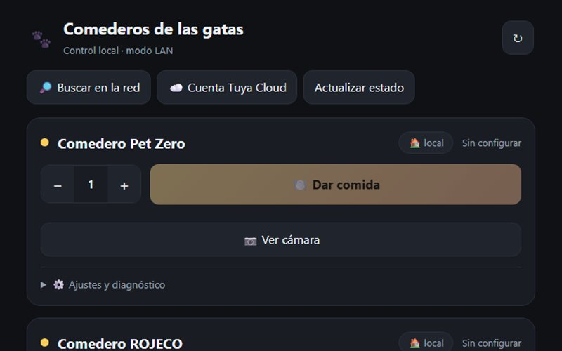

<h1 align="center">Comederos de las gatas</h1>

Una sola web para controlar dos comederos inteligentes, por WiFi local o por la nube.

<a href="https://sotomontes.com/#comederos-de-las-gatas"><b>Ver en sotomontes.com</b></a>

**Autor:** Sebastian Sotomontes · © 2026

> Esta página es solo una presentación del proyecto. El código y los instaladores son privados.

---

## Funciones

- **Una sola web** para dar de comer desde dos comederos inteligentes.
- **Modo local** por WiFi, rápido y sin nube.
- **Modo nube** para usarlo desde cualquier lugar.
- **Modo demo** con comederos simulados.
- **Porciones** ajustables y vista de cámara.

## Tecnologías

Python · Tuya

**Créditos:** usa tinytuya.

© 2026 Sebastian Sotomontes. Todos los derechos reservados.
