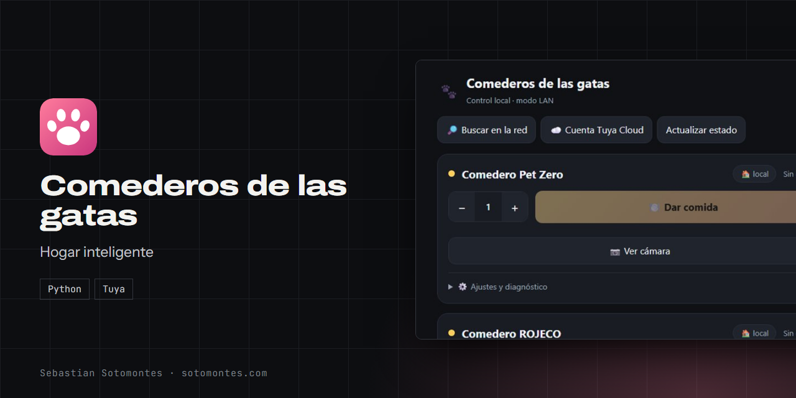
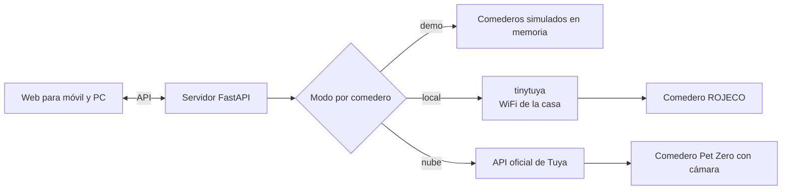

Una sola web para controlar dos comederos inteligentes, por WiFi local o por la nube.

<a href="https://sotomontes.com/#comederos-de-las-gatas"><b>Ver en sotomontes.com</b></a> · <a href="#cómo-se-usa">Cómo se usa</a> · <a href="#cómo-funciona-por-dentro">Cómo funciona</a> · <a href="#novedades">Novedades</a>

| Ficha técnica | |
|---|---|
| **Autor** | Sebastian Sotomontes |
| **Tipo** | Hogar inteligente |
| **Plataforma** | PC o NAS con Docker |
| **Versión** | 1.0 |
| **Estado** | Funcional |
| **Stack** | Python · Tuya |
| **Código** | Privado. Esta página es solo una presentación. |

---

## Qué es

Comederos de las gatas es una aplicación web que unifica el control de dos comederos inteligentes, Pet Zero y ROJECO, sin depender del celular ni de tener cada app instalada. Funciona desde el computador o desde cualquier móvil de la casa.

## Novedades

- Importación automática de dispositivos y vista de cámara.

## Cómo se usa

1. Arranca el servidor en tu PC o en un NAS con Docker, y abre la web.
2. Empieza en **modo demo** para probar la interfaz sin tocar nada real.
3. Crea un proyecto gratuito en Tuya, vincula tu cuenta y pega sus credenciales en **Cuenta Tuya Cloud**.
4. Pulsa **Importar mis dispositivos** y asigna cada comedero. La app elige sola el modo local o nube.
5. Elige las porciones con **+** y **−** y pulsa **Dar comida**.
6. Si tu comedero tiene cámara, pulsa **Ver cámara**.

## Funciones

- **Una sola web** para dar de comer desde dos comederos inteligentes.
- **Modo local** por WiFi, rápido y sin nube.
- **Modo nube** para usarlo desde cualquier lugar.
- **Modo demo** con comederos simulados.
- **Porciones** ajustables y vista de cámara.

## Detalles

- Modo local: habla directo con el comedero por WiFi, rápido y sin nube.
- Modo nube: control desde cualquier lugar.
- Modo demo: comederos simulados.
- Cada comedero se configura por separado, y cambiar de modo no cambia la interfaz.

## Privacidad y seguridad

Las claves de tus dispositivos se guardan solo en tu servidor.

## Cómo funciona por dentro

### Arquitectura

### Una sola interfaz para tres modos

Los modos demo, local y nube comparten la misma API, así que cambiar de modo no cambia la web. Cada comedero tiene su propio modo en sus ajustes.

- **Demo:** es el modo por defecto. Sirve para probar el botón y el contador de porciones sin tocar hardware.
- **Local:** habla directo con el comedero por la red, usando su identificador, su IP y su clave local. Es rápido y no depende de internet, pero funciona solo dentro de la casa.
- **Nube:** usa la API oficial de Tuya para controlar desde cualquier lugar.

### Importación automática

Con las credenciales de un proyecto de Tuya, la app trae tus dispositivos y resuelve sus claves. Al asignar cada comedero elige el modo sola: local si está en tu red con clave, y nube si tiene cámara o no tiene IP local.

### Cámara

Los comederos con cámara solo se controlan y se ven por la nube. La app pide a Tuya una dirección de streaming temporal. Como el navegador no reproduce RTSP directamente, se abre en un reproductor externo o se pasa por un puente a HLS para verla dentro de la web.

### Despliegue

Corre en un PC o en un NAS con Docker. Se puede limitar a un solo equipo o abrir a toda la red local.

**Créditos:** usa tinytuya.

---

© 2026 Sebastian Sotomontes. Todos los derechos reservados.
